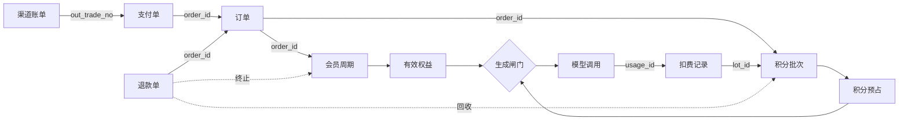
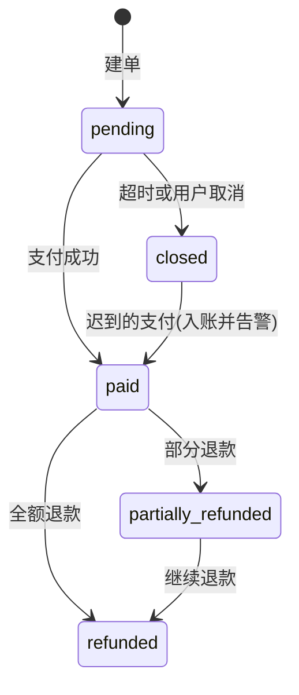
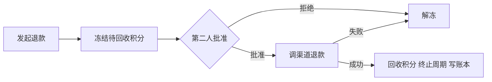

# 用户权限与支付体系设计

状态：阶段 0–5 的代码已实现（未提交）。第 2 节的问题 1、2、4、5、6、7、8、9、10、13 已解决。**扣费默认关闭**（`BILLING_ENFORCE=0`），开启前先看 5.7 节。

**两个完成标准还没达到：** 阶段 4 的“小额真实支付和退款走通”需要商户号、密钥和公网 https 回调地址，阶段 5 的“连续 7 天对账差异全部有解释”需要真实收款后的 7 天账单。目前只用按官方协议写的模拟渠道测过，真实联调的步骤见 4.7 节，第 6 节列出了还没做的联动。

## 1. 结论

一个请求能不能执行，要依次过五关。前两关管“你是谁、能管什么”，第三关管“这是不是你的东西”，后两关管“你买了什么、还剩多少”：

```text
账号状态 → 操作权限(RBAC) → 资源归属 → 套餐权益 → 积分余额
```

权限和支付靠一条单向的数据链连起来，链上每一环都带着上一环的编号：



- **钩稽：** 第 7 节的 10 条等式。比如“每笔已支付订单对应且只对应一笔积分入账”。每天自动核对，差异进入差异单，由财务处理。
- **联动：** 第 6 节的事件表。比如“付款成功 → 发积分 → 开通权益 → 恢复因余额不足暂停的项目”。
- **账只追加：** 账本记录不改不删，纠错只能追加一笔冲正。

## 2. 现状

这个项目已有不少可用的基础：`platform_users.role`、`get_current_user`、`require_admin`（27 处路由在用）、项目归属检查、`payment_orders`、`billing_ledger`、幂等的回调表、审计表，以及记录每次模型调用的 `usage_ledger`。

下面这些问题决定了设计的重点：

| # | 问题 | 位置 | 后果 |
|---|---|---|---|
| 1 | **任何登录用户都能免费拿积分**：`sandbox` 是默认渠道，自己建单、自己确认就入账，没有环境开关 | `billing_api.py` 的 `sandbox-confirm`，`BillingCenterPage.tsx` | 现在积分没用途所以没损失，一旦开始扣费就等于白送 |
| 2 | **积分从不扣减**，生成也不查余额或会员 | 全项目搜索不到扣减逻辑；`get_membership` 只用于用户中心展示 | 付费买不到任何实际权益 |
| 3 | **微信、支付宝没有真正接入**：`create_order` 直接拒绝；回调用的是自定义 HMAC 信封，不是两家的真实协议 | `store.py:create_order`，`payments.py` | 回调要重写 |
| 4 | **删除用户会连带删除订单和账本**：外键都是 `ondelete=CASCADE` | `models.py` 的 `PaymentOrder`、`LedgerEntry`、`UserMembership` | 财务记录可能丢失。目前没有删除用户的接口，但数据库层面没有防护 |
| 5 | **用量记录不能当记账依据**：只存在项目 JSON 里且最多保留 5000 条；没绑定项目的调用只进内存队列，重启即丢 | `usage_ledger.py` 的 `MAX_RECORDS_PER_TASK`、`unattributed` | 无法逐笔对账 |
| 6 | **有的调用根本没记账**：配音 `synthesize_preferred_dialogue_track` 不写用量；元素库生图没有 `bind_task` | `media_compositor.py`，`element_api.py` | 这部分成本收不到钱 |
| 7 | **参考价格表默认不存在**：`runtime/model_pricing.json` 没有配置，估价全部是“未定价” | `providers/pricing.py` | 无法算出该扣多少积分 |
| 8 | **`editor` 角色没有后端含义**：后端只校验取值，不据此判断任何权限 | `store.py:admin_update_user` | 管理员只有“全有或全无”，财务和客服无法分开 |
| 9 | **两份几乎相同的入账代码** | `store.py` 的 `confirm_paid_order`、`process_webhook_payment` | 规则容易改漏 |
| 10 | **续费会丢失剩余时长**：到期时间直接覆盖成“现在 + 30 天” | 同上 | 提前续费的用户吃亏 |
| 11 | **余额靠全表累加，每次还返回全部流水** | `store.py:wallet` | 流水变多后会变慢 |
| 12 | **订单号是 36 位 UUID**，微信要求 `out_trade_no` 不超过 32 位 | `PaymentOrder.id` | 不能直接当商户单号 |
| 13 | **只有 `create_all`，没有迁移工具**，它不会给已有表加列 | `store.py:create_schema` | 改表要先定迁移方案（见 11 节） |

## 3. 权限体系

### 3.1 三件事分开管

| 概念 | 回答的问题 | 存放位置 | 来源 |
|---|---|---|---|
| 操作角色 | 这个人在公司里能管什么 | `user_roles` | 管理员授予 |
| 资源归属 | 这个项目、素材是谁的 | `owner_user_id`、`owner_id`（已有） | 创建时确定 |
| 套餐权益 | 这个客户买了什么 | `membership_terms` | **只能由已支付订单或带审计的赠送产生** |

最关键的一条：**花钱买不到管理权限，管理员角色也不自动带来额度。** 这两条线分开，财务数据才可信。

### 3.2 统一判定入口

所有检查走同一个函数，路由和生成流程不再各写一套：

```python
decision = authorize(actor, permission="stage:run", resource=task, feature="video:2k", cost=estimate)
# decision.allowed / decision.reason / decision.upgrade_hint
```

| 检查顺序 | 不通过时 | 返回 |
|---|---|---|
| 1. 账号正常，不需要先改密码 | `account_suspended`、`must_change_password` | 401 / 403 |
| 2. 操作权限 | `permission_denied` | 403 |
| 3. 资源归属，或持有 `*_any` 权限 | `not_found`（不暴露资源是否存在） | 404 |
| 4. 套餐包含该功能 | `feature_not_in_plan`，附可升级的套餐 | 402 |
| 5. 积分够预占 | `insufficient_points`，附缺口和充值入口 | 402 |

路由层用 `Depends(require_permission("order:refund_approve"))` 取代 `require_admin`。再加一个测试扫描所有路由：管理类路由如果没有声明权限，测试就失败。

### 3.3 操作角色

角色和权限的对应写在代码里，随代码评审和发布，不做后台任意编辑。这样谁能动钱一看代码就清楚。一个用户可以有多个角色。

| 权限 | super_admin | ops 运维 | finance 财务 | support 客服 | auditor 审计 |
|---|---|---|---|---|---|
| `role:assign` 授予角色 | ✓ | | | | |
| `user:read` 查看用户 | ✓ | | ✓ | ✓ | ✓ |
| `user:manage` 停用账号、重置 | ✓ | | | ✓ | |
| `model_config:manage` 模型配置 | ✓ | ✓ | | | |
| `skill:manage`、`market:manage`、`capability:manage` | ✓ | ✓ | | | |
| `project:read_any` 查看他人项目 | ✓ | ✓ | | ✓ | ✓ |
| `project:write_any` 操作他人项目 | ✓ | ✓ | | | |
| `pricing:manage` 套餐与积分费率 | ✓ | | ✓ | | |
| `order:read_any` 查看全部订单 | ✓ | | ✓ | ✓ | ✓ |
| `refund:request` 发起退款 | ✓ | | ✓ | ✓ | |
| `refund:approve` 批准退款 | ✓ | | ✓ | | |
| `wallet:adjust_request` 发起积分调整 | ✓ | | ✓ | ✓ | |
| `wallet:adjust_approve` 批准积分调整 | ✓ | | ✓ | | |
| `recon:read` 查看对账 | ✓ | | ✓ | | ✓ |
| `recon:resolve` 处理差异 | ✓ | | ✓ | | |
| `payment:configure` 支付开关 | ✓ | | | | |
| `audit:read` 查看审计 | ✓ | | ✓ | | ✓ |

**动钱的操作要两个人：** 退款和积分调整，发起人和批准人不能是同一人，`super_admin` 也不例外。小额退款可以按配置的阈值免第二人（默认关闭）。

现有角色这样迁移：`admin` → `super_admin`；`editor` → 普通用户；`user` 不变。权限只读 `user_roles`，`role` 列仍随角色同步写入，用于回退，下个版本删除。

跨账号访问写审计（`platform_audit_events`）：读取同一项目 10 分钟内只记一次，因为界面会轮询；写入每次都记。不经过 FastAPI 工作线程的调用写不进表时，退回写日志并告警。审计记录在财务后台可以查看（接口 `GET /api/admin/audit-events`）。

### 3.4 套餐权益

权益写在套餐里，下单时连同价格一起快照到订单。**之后调整套餐不影响已购买的用户。** 下面的数值是建议的初值，由你确定：

| 权益键 | free | starter ¥29 | studio ¥129 | pro ¥399 |
|---|---|---|---|---|
| `points.monthly` | 试用赠送一次 | 500 | 3000 | 10000 |
| `project.max` | 2 | 10 | 50 | 不限 |
| `video.max_resolution` | 768p | 768p | 2K | 2K |
| `generation.max_parallel` | 1 | 2 | 4 | 8 |
| `storage.max_gb` | 1 | 10 | 100 | 500 |
| `mcp.access` | | | ✓ | ✓ |
| `export.jianying` | | ✓ | ✓ | ✓ |

会员到期后退回 `free`。判定时按 `expires_at` 现场计算，不依赖定时任务改状态，任务延迟也不会多给权益。

### 3.5 检查放在哪里

| 位置 | 查什么 | 说明 |
|---|---|---|
| `get_current_user` | 账号状态 | 已有。每次都读库，所以停用和改角色立刻生效 |
| 各路由 | 操作权限、归属 | 把 `require_admin` 换成 `require_permission` |
| `_claim_stage_task` 和视频准入 | 权益、积分预占 | 真正花钱前的主闸门 |
| 元素生图、画布、智能体工具、互动故事 | 同上 | 这些路径不经过阶段流程，必须单独接入 |
| MCP 入口 | 账号状态、`mcp.access` | 令牌继承所属用户的权限 |
| `ModelGateway` | 没有扣费上下文的调用记录告警 | 兜底，防止新路径漏接 |

## 4. 支付体系

### 4.1 渠道选择

| | 支付宝 | 微信 |
|---|---|---|
| 产品 | 当面付的订单码支付 | Native 支付 |
| 下单 | `alipay.trade.precreate`，`product_code` 传 `QR_CODE_OFFLINE`，返回 `qr_code` ✓ | `POST /v3/pay/transactions/native`，返回 `code_url` ✓ |
| 金额 | 元（字符串） | 分（整数） |
| 商户单号 | 不超过 64 位，字母、数字、下划线 ✓ | 6–32 位，字母数字和 `_-|*`，商户号内唯一 ✓ |
| 通知验证 | 支付宝公钥验签 ✓ | `Wechatpay-Signature` 验签，AES-256-GCM 解密 ✓ |
| 成功状态 | `TRADE_SUCCESS` 或 `TRADE_FINISHED` ✓ | `trade_state = SUCCESS` ✓ |
| 通知应答 | 输出 `success`，否则重试 ✓ | 200 或 204，须 5 秒内应答 ✓ |
| 账单 | `alipay.data.dataservice.bill.downloadurl.query`，`bill_type=trade`，链接 30 秒有效，压缩包内是明细和汇总两张表 ✓ | `GET /v3/bill/tradebill`，T+1 上午 10 点后可取，下载时用 SHA1 校验 ✓ |

✓ 表示已对照官方文档核实。支付宝退款接口（`alipay.trade.refund`）的文档页抓取为空，字段取自官方 SDK 的模型。支付宝账单的列名和 `退款批次号` 的含义有官方说明 ✓，但列可以由商家自定义，文件里 `#` 开头的说明行也没有文档依据，所以按表头读取，读不懂就报错。这两处**真实联调时要重点核对**。

**二维码有效期两家不一样：** 界面统一显示 15 分钟。微信通过 `time_expire` 限定 ✓。支付宝的订单码固定有效 2 小时，文档没有更短的时限参数 ✓，而且没人扫过的码还不算交易，关单不起作用，所以界面上过期或取消后它仍可能被付款。这笔钱按“关单后才付款”处理（见 4.2），后台在 2 小时 15 分内每 5 分钟查一次已关闭的支付宝码，防止恰好通知也丢失。

**扫码支付不能自动续费。** 所以这里的会员都是一次性购买的固定周期，到期前提醒用户再次付款。

### 4.2 订单和支付单分开

现在一张订单绑死一个渠道。实际上用户可能先扫支付宝没付、再换微信，所以拆成两层：

- **订单 `payment_orders`：** 买什么、多少钱、商品快照。
- **支付单 `payment_attempts`：** 每次在某渠道出码产生一条，有自己的 `out_trade_no`（`P` + 日期 + 随机串，不超过 32 位）。



需要专门处理的情况：

| 情况 | 处理 |
|---|---|
| 换渠道 | 先在渠道侧关闭旧支付单，再出新码 |
| 两个码都付了 | 第一笔入账，第二笔自动发起全额退款并告警 |
| 关单后才付款 | 钱已经收到，正常入账并告警，不让用户付了钱却没权益 |
| 通知金额、商户号不符 | **不入账**，生成严重差异单。签名是对的，所以仍应答成功，避免渠道一直重试 |
| 通知没来 | 主动查单（见 4.4） |

### 4.3 入账只有一处

合并成一个函数，三个来源（通知、查单、对账补单）都调用它：

```python
apply_payment(provider, out_trade_no, channel_trade_no, amount_minor, currency, paid_at, source)
```

一个数据库事务内完成：

1. 校验金额、币种、商户号。
2. 条件更新 `attempt: pending → paid`。**更新到 0 行就说明别人已入账，直接返回。** 这比行锁更通用，SQLite 开发环境下同样成立。
3. 条件更新订单为 `paid`。如果订单已被另一张支付单付过，转入“两个码都付了”的流程。
4. 写入 `billing_ledger`、`point_lots`、`membership_terms`。
5. 写入事件发件箱（见第 6 节）。

幂等靠唯一约束：`(provider, channel_trade_no)`、`out_trade_no`，以及账本的 `idempotency_key`。

### 4.4 通知和查单两条路都要有

微信文档明确要求不能只依赖回调 ✓，内网部署也可能收不到通知。

- **通知：** 先验签，失败返回 4xx。微信的 `WECHATPAY/SIGNTEST/` 探测签名不做特殊判断，按正常报文验签即可 ✓，所以它会自然验签失败。验签通过后写入事件表并入账，5 秒内应答。通知里除了验签，还要核对金额、币种、商户号和应用 ID。
- **前端轮询：** `GET /orders/{id}` 每 3 秒一次，服务端对同一支付单最多每 5 秒查一次渠道。
- **后台补偿：** 每分钟扫描未超时的支付单；超时的先查一次，确认没付再关单。

### 4.5 渠道适配层

```python
class PaymentChannel(Protocol):
    def create_qr(self, attempt) -> QrCode: ...
    def query(self, out_trade_no) -> ChannelTrade: ...
    def close(self, out_trade_no) -> None: ...
    def parse_notification(self, headers, body) -> ChannelEvent: ...  # 验签在这里，失败抛异常
    def refund(self, refund) -> ChannelRefund: ...
    def query_refund(self, out_refund_no) -> ChannelRefund: ...
    def download_bill(self, day) -> list[BillRow]: ...  # 阶段 5
```

放在 `app/platform/payments/`，分 `alipay.py`、`wechat.py`，取代原来的 `payments.py`。上层只认内部的“分”，元和分的换算只在适配层出现。官方提供了 SDK，但微信 v3 的官方 SDK 没有 Python 版 ✓，所以两家的签名都是自己写的，由 `tests/test_payment_channels.py` 重点覆盖。

微信只支持**微信支付公钥**模式，还在用平台证书的商户需要先在商户平台开启公钥。

配置不全的渠道不会出现在可选列表里，它的通知地址也返回 404。

**沙箱渠道：** 默认关闭，只有 `PAYMENT_SANDBOX_ENABLED=1` 才可用，继续走原来的 `sandbox-confirm`。支付宝有官方沙箱可以联调；微信是否有可用沙箱我没能确认，按小额真实订单加退款来计划。

**密钥：** 商户私钥、微信 APIv3 密钥只从环境变量或磁盘文件读取，不进数据库，不回显，不写日志。后台只能看到“已配置”和证书到期时间。

**二维码：** 前端用本地库渲染，不把支付链接发给第三方生成二维码的服务。

### 4.6 退款



**金额规则（默认）：** `退款额 = 实付 × 未用积分 / 发放积分`，向下取整到分。财务可以在批准时改金额，改动写入审计。

已用完的积分不能倒扣成负数。发起退款时先冻结，避免审批期间用户把积分花掉。全额退款则终止会员周期，部分退款只回收对应积分。

**已实现的规则：** 一笔订单同时只能有一笔退款在处理。有未处理的严重对账差异时，不能发起也不能批准。默认可回收积分是“批次剩余”和“可用余额”中较小的一个，正在调用中预占的积分留给那次调用。批准时改金额会写入审计。全额退款后周期状态变为 `refunded`，积分批次也不再可用；部分退款后周期继续有效。渠道未配置时拒绝批准，否则积分会一直冻结。

只有一种退款不需要审批：同一订单被付了两次时，把第二笔全额退回。这笔钱没有发放过任何东西，不涉及回收。退款号固定，超时后用同一个号重发，渠道只会退一次。微信受理不等于成功，要查到最终状态；支付宝查询接口没返回 `REFUND_SUCCESS` 就表示没退成，按文档用同一个号和金额重发 ✓。退款失败是终态，写告警等人处理。

### 4.7 真实联调

代码已就绪，但缺少商户资料，所以还没有走过真钱。走通需要：

1. **商户资料：** 支付宝开通当面付；微信开通 Native 支付并启用公钥。两边都配到环境变量（见 `backend/.env.example`），密钥只放磁盘文件。
2. **公网地址：** `PAYMENT_NOTIFY_BASE_URL` 必须是公网 https，否则两个渠道都不启用。
3. **小额验证（每家各做一遍）：** 付 0.01 元（需要临时建一个对应价格的套餐），确认通知入账；断开通知地址再付一笔，确认靠查单入账；同一订单扫两个码都付，确认第二笔自动退回。
4. **重点核对：** 支付宝退款字段和账单文件的实际样子（上文说明了来源）；两家真实应答的验签。
5. **退款：** 在财务后台由一人发起、另一人批准，确认钱退回、积分回收、差异单为空。

告警目前没有推送，要有人看：财务后台的“对账差异”“审计记录”（`payment.*`、`recon.critical`），以及日志中的“支付告警”“对账严重差异”。

## 5. 积分与扣费

### 5.1 按“预占—结算—释放”扣费

生成一次可能跑很久，中途还可能失败或重启，所以不能事先一次扣死：

| 步骤 | 时机 | 动作 |
|---|---|---|
| 预占 | 阶段开始、视频准入通过 | 按估价占用积分，不够就返回 402，**一次模型调用都不发** |
| 结算 | 每次模型调用成功 | 按实际用量扣费，从预占额中划走 |
| 释放 | 阶段结束 | 退回没用完的部分 |
| 兜底 | 进程崩溃导致预占超时 | 后台任务释放，已结算的不受影响 |

**失败的调用不扣费。** 视频任务重启后续跑时已有 `5_jobs` 机制，结算以 `usage_id` 和作业键保证不重复扣。

如果实际超过预占（比如重试变多），允许本次超支，积分最低扣到 0，缺口记入差异单。下一次预占时因余额不足会被挡住。

实现时把预占放在了每次调用上（`usage_ledger.timed_call` → `BillingBook.reserve`），而不是每个阶段一次：这样任何路径的付费调用都逃不掉，也不需要为每个阶段估价。第 5 阶段视频另外在开始前检查整批费用，避免做到一半没钱。拒绝用 `BillingRefused`，它继承 `BaseException`，这样不会被流程里大量的 `except Exception` 当成普通失败去重试或走兜底。

### 5.2 费率

积分费率独立成表，不直接用服务商价格，这样调价不影响历史记录：

```text
积分 = 实际用量 × 单位费率（保留 4 位小数）    费率按 (模型, 分辨率) 配置，只追加，不追溯
```

一次短文本调用只有零点几积分，逐次向上取整会让费用翻很多倍，所以不取整。

**没配费率的模型不对客户开放。** 现在估价时未定价的模型只是提示，收费后必须拒绝，否则就是免费用。第一次上线前要把 `model_pricing.json` 和费率表都填好。

### 5.3 用量记账独立入库

`usage_records` 继续留在项目里给界面展示。计费新增一张数据库表 `usage_charges`，每次调用一行，`usage_id` 唯一。

- 登录时 `bind_user` 记下发起人。有项目的调用由项目所有者付；发起人不是所有者时记为 `operator_absorbed`；没有项目的调用由发起人付。都找不到记为 `unattributed`，在对账结果里单独显示。
- 配音、音乐、音效在 `ElevenLabsClient`、`MiniMaxAudioClient` 的收费方法上记账，上层不用各写一遍。
- 新开的线程和线程池要带上上下文（`carrying_context`、`copy_context`），否则调用就没有归属。
- 每次调用先写本地文件 `runtime/usage_spool/`，再由后台每 5 秒导入数据库；导入失败文件保留，下次重试。按 `usage_id` 去重，重放不会多记。

相关接口：`/api/admin/pricing/rates`（费率）、`/api/admin/finance/usage`（按模型汇总积分和参考成本）、`/api/admin/recon/usage`（R6、R7，查询时现算）。

### 5.4 积分批次

每笔入账是一个批次，记录来源订单、剩余量、到期时间和**每积分对应的金额**。这样积分和钱才对得上（第 7 节 R9）。

消耗时优先用最早到期的。套餐积分随周期到期，加购的积分包不过期（默认值）。到期作废写一笔 `points_expired` 账本。

### 5.5 谁付钱

| 场景 | 处理 |
|---|---|
| 用户运行自己的项目 | 项目所有者付 |
| 客服、运维操作他人项目 | 记录 `operator_id`，归入 `operator_absorbed`，**不扣客户积分** |
| 内部账号 | `billing_exempt`，仍写 0 积分的记录，对账照样平 |
| 智能体、MCP、自动流程 | 按所属用户正常扣 |

### 5.6 续费和升级

| 操作 | 规则 |
|---|---|
| 同套餐续费 | 从 `max(现在, 当前到期)` 顺延，修复问题 10 |
| 升级 | 立即生效，旧套餐积分保留到原到期日 |
| 降级 | 当前周期结束后生效 |
| 到期 | 权益退回 free；进行中的阶段跑完；不能开始新的付费阶段 |

### 5.7 开启扣费前

设 `BILLING_ENFORCE=1` 并重启。启动时会作废沙箱积分（生产环境），没有费率的模型和 2K 视频会被拒绝。开启前确认：

1. MiniMax 账单：失败的任务是否收费（见 RATE-PROPOSAL 第 5 节）。
2. 真实调用的 `/api/admin/recon/usage`、`/api/admin/recon/billing` 差异为 0。
3. 阶段 4 的真实支付渠道已接通，否则用户付不了钱，只能被拒绝。
4. 3.4 节的权益数值是你确认过的。

超级管理员等持有后台角色的账号不扣费（记为 `exempt`），所以要用普通账号验证。

已知缺口：
- `generation.max_parallel` 和 `storage.max_gb` 还没有执行。
- 崩溃后恢复的视频任务（`5_jobs` 续跑）既不记账也不扣费。
- 外部 Agent 密钥发起且没绑定项目的调用会被拒绝，因为找不到付费账号。

## 6. 联动

最初设计是状态变化先写发件箱 `billing_events`，再由处理器消费。**实际没有做发件箱：** 账本、积分、权益、令牌和通知都在同一个数据库，放进同一事务更简单，也不存在“发了事件但处理失败”的中间状态。只有两件事在事务之外：关闭渠道上的付款码、停止项目（`account_linkage.py`）。它们失败不影响账号已关闭，付款码由补偿任务继续关，项目失败会写审计，新的模型调用反正已被拒绝。

下表“状态”一列是现在的实际情况。

| 事件 | 联动结果 | 状态 |
|---|---|---|
| 订单已付 | 发积分、开周期、刷新权益、站内通知；从项目来充值的，付款后提供“回到项目” | 已实现 |
| 订单关闭 | 前端二维码失效 | 已实现 |
| 重复支付 | 自动退第二笔、写告警 | 已实现 |
| 发起退款 | 冻结待回收积分 | 已实现 |
| 退款成功 | 回收积分、全退时终止周期、重算权益、通知用户 | 已实现。多付自动退回也通知 |
| 退款失败 | 解冻、写告警 | 已实现 |
| 会员将到期 | 到期前 7 天、1 天站内提醒，已续费的不提醒 | 已实现 |
| 会员已到期 | 权益退回 free，积分批次作废，站内通知 | 已实现 |
| 停用用户 | 关闭未付订单、释放预占、撤回排队项、停止运行中的项目、吊销 MCP 令牌；退款不受影响 | 已实现。重新启用不会恢复这些，令牌要重新创建，项目由用户点继续 |
| 删除用户 | 匿名化，财务记录保留，同时做停用的全部联动，不可恢复 | 已实现。**项目和素材内容没有删除**，见下文 |
| 角色变更 | 写审计；每次请求都读库，所以立即生效 | 已实现 |
| 积分不足 | 阶段暂停并保留进度，提示充值 | 已实现 |
| 严重差异 | 涉及的订单不能再退款，直到差异处理完；后台人员的通知铃铛显示待办 | 已实现 |

**停用后的模型调用：** 所有模型调用都经过 `usage_ledger` 这一个入口，账号不在正常状态时直接拒绝，扣费关闭时也一样（`AccountGuard`），所以画布、演播室这些没有逐个停止的任务，也发不出新调用。其他进程最多一分钟后生效；已经提交给服务商的任务会跑完。状态查询失败时放行并写日志，因为一次数据库故障不该让所有生成停摆。

**通知的范围：** 只有站内通知，没有短信、邮件和应用外推送，铃铛目前只在创作大厅显示。给后台人员的待办（待审批退款和积分调整、严重差异、近 7 天支付告警）是打开时现算的，不存记录，也就不会过期或重复；只显示这个人能处理的。

**删除账号留下了什么：** 清除用户名、邮箱、手机、昵称和密码，账号不能再登录，邮箱可以重新注册。订单、账本、审计原样保留。审计和退款备注里人工写过的文字不会改写。用户的项目和素材留在数据库里，只是没人能打开；要不要、多久后彻底删除，取决于隐私政策，见第 13 节。

**付款后不自动继续生成。** 恢复意味着继续花钱，所以默认由用户点“继续”，也可以在开始前选“付款后自动继续”。

## 7. 钩稽关系

### 7.1 等式

| # | 核对内容 | 等式 | 频率 |
|---|---|---|---|
| R1 | 渠道 ↔ 支付单 | 账单每一行都能按 `out_trade_no` 找到支付单，金额相等，反之亦然 | 每日 |
| R2 | 支付单 ↔ 订单 | 已付订单恰好有一笔已付支付单；多出来的必须有退款单 | 每小时 |
| R3 | 订单 ↔ 发放 | 每笔已付订单恰好一笔积分入账、一个批次、一个周期，数量等于下单时的快照 | 每小时 |
| R4 | 退款 | 渠道退款成功 ⇔ 退款单成功 ⇔ 有回收账本；累计退款 ≤ 实付 | 每日 |
| R5 | 积分余额 | 期初 + 发放 − 消耗 − 回收 − 作废 + 调整 = 期末 = 批次剩余之和 = 可用 + 预占 | 每小时 |
| R6 | 用量 ↔ 扣费 | 每个 `usage_id` 恰好一条扣费记录，积分等于用量 × 当时费率 | 每小时 |
| R7 | 项目 ↔ 计费 | 项目 `usage_records` 能找到对应的 `usage_charges`，反之亦然（超出保留上限的不查） | 每日 |
| R8 | 权益 ↔ 订单 | 每个有效周期都由未全退的订单或带审计的赠送支撑；付费功能的使用都落在有效周期内 | 每日 |
| R9 | 钱 ↔ 积分 | 实收 − 退款 = 已确认（已消耗、已作废积分的金额）+ 递延（剩余积分的金额） | 每日 |
| R10 | 操作 ↔ 审计 | 每笔人工调整、退款批准、角色变更都有同一事务写入的审计记录，操作人当时持有对应权限，且发起人≠批准人 | 每日 |

R9 把钱和积分连起来，也回答了“收的钱里多少已经赚到、多少还欠用户”。在此基础上，用 `usage_charges` 的参考成本还能算出每个用户、每个项目的毛利。财务后台目前只显示总毛利，按用户和项目拆分还没做。

**实现说明（`app/platform/reconciliation.py`）：**

- **频率：** R2、R3、R5、R6 每小时一次。每天上午 10:30（北京时间）之后下载前 3 天缺的账单，再跑全部十条。财务也可以手动运行。多个进程同时运行时，同一周期只跑一次。
- **R5** 还按批次逐行核对：发放 − 账本记录的消耗、到期、回收、调整 = 剩余。
- **R8** 的“付费功能使用”目前只查视频分辨率，其他权益（如并发数）还没有可查的使用记录。
- **R9** 多一项“退款差额”：退款金额和被回收积分的价值之差，来自取整或人工改额。每个批次允许 1 分的取整误差。
- **R10** 的“操作人当时持有权限”靠审计记录里写入的操作人角色判断。角色变更只查有没有审计记录。
- 没有商户配置时 R1 没有账单可比，也不会报错；已入账却超过 2 天没有账单才报“账单缺失”。

### 7.2 差异处理

对账结果写入 `recon_runs` 和 `recon_items`。

| 差异 | 严重度 | 处理 |
|---|---|---|
| 渠道有，本地没入账 | 严重 | 查单确认后自动调 `apply_payment` 补账 |
| 本地已付，渠道没有 | 严重 | 不自动处理，人工核查，涉及的订单冻结退款 |
| 金额不一致 | 严重 | 人工处理 |
| 跨日时间差（23:59 付款） | 提示 | 第二天复核，对上后自动关闭 |
| 重复扣费、重复发放 | 严重 | 确认后追加冲正记录 |
| 用量无扣费记录 | 警告 | 按当时费率补扣 |

差异单的状态是 `open → auto_resolved / resolved / ignored`。人工处理必须填写原因并写审计。已被人解释过的差异，复核时数值没变就不再打开，变了就开新单。**任何修正都只能追加冲正记录，不能改原记录。** 差异单本身不动账，修正走积分调整（同样要两个人）。

“用量无扣费记录按当时费率补扣”目前只报警告，不会自动补扣；“重复发放确认后冲正”也要人工发起积分调整。自动处理的只有“渠道有、本地没入账”这一种。

## 8. 数据模型

### 新增

| 表 | 关键字段 |
|---|---|
| `user_roles` | `user_id`、`role`、`granted_by`、`granted_at`；唯一 `(user_id, role)` |
| `payment_attempts` | `order_id`、`provider`、`merchant_id`、`out_trade_no` 唯一、`channel_trade_no`、`amount_minor`、`status`、`expires_at`、`paid_at`；唯一 `(provider, channel_trade_no)` |
| `payment_refunds` | `order_id`、`attempt_id`、`out_refund_no` 唯一、`channel_refund_no`、`amount_minor`、`points_clawback`、`status`、`reason`、`requested_by`、`approved_by`；检查 `requested_by <> approved_by` |
| `membership_terms` | `user_id`、`order_id`、`plan_id`、`entitlements`（快照）、`starts_at`、`expires_at`、`status` |
| `point_lots` | `user_id`、`order_id`、`granted`、`remaining`、`unit_value_minor`、`expires_at`；检查 `remaining >= 0` |
| `point_balances` | `user_id` 主键、`available`、`held`。可由批次和预占重算，R5 负责核对 |
| `point_holds` | `user_id`、`task_id`、`stage`、`amount`、`captured`、`status`、`expires_at`、`idempotency_key` 唯一 |
| `usage_charges` | `usage_id` 唯一、`user_id`、`task_id`、`hold_id`、`model`、`media_type`、`units`、`points`、`rate_id`、`reference_cost`、`operator_id`、`billing_mode` |
| `point_rates` | `media_type`、`model`、`resolution`、`points_per_unit`、`effective_from`。只追加，新费率即新行 |
| `channel_bills`、`channel_bill_rows` | 每日账单的摘要和逐行内容 |
| `wallet_adjustments` | `user_id`、`points`、`reason`、`status`、`requested_by`、`approved_by`；检查 `requested_by <> approved_by` |
| `recon_runs`、`recon_items` | `rule`、`severity`、`left_ref`、`right_ref`、`expected`、`actual`、`status`、`resolved_by`、`resolution` |

### 修改

| 表 | 改动 |
|---|---|
| `membership_plans` | 加 `kind`（`membership`、`points_pack`）、`entitlements`；加 `free` 套餐 |
| `payment_orders` | 加 `snapshot`、`expires_at`、`refunded_minor`；`provider` 改为可空（移到支付单）；外键改 `RESTRICT` |
| `billing_ledger` | 加 `lot_id`、`usage_id`、`refund_id`、`actor_id`；外键改 `RESTRICT` |
| `user_memberships` | 外键改 `RESTRICT`；降级为“当前周期”的缓存 |
| `payment_webhook_events` | 保留，改存渠道事件的摘要 |

账本和审计表在 PostgreSQL 上有触发器，拒绝 `UPDATE` 和 `DELETE`（`migrate.py`，每次启动确保存在）。SQLite 开发环境没有这层保护。

实际和上表的差别：没有 `billing_events`（见第 6 节）；`payment_orders` 没有加 `snapshot`、`expires_at`、`refunded_minor`，已退金额由退款单算出，未付订单超过 24 小时自动关闭；`provider` 未改为可空，未选渠道时是空字符串；`point_lots`、`point_balances` 多了 `frozen`。

`billing_ledger.category` 的取值固定为：`membership_purchase`、`points_pack_purchase`、`usage_charge`、`refund_clawback`、`points_expired`、`manual_adjust`、`reversal`。

## 9. API

| 接口 | 权限 | 说明 |
|---|---|---|
| `GET /api/billing/plans` | 公开 | 已有 |
| `GET /api/billing/wallet` | 本人 | 改为读余额表，流水分页 |
| `GET /api/billing/entitlements` | 本人 | 当前权益和到期时间，供前端判断按钮状态 |
| `POST /api/billing/orders` | 本人 | 已有。入参 `plan_id`、`idempotency_key`，**价格只看服务端** |
| `POST /api/billing/orders/{id}/pay` | 本人 | 入参 `provider`，返回二维码内容和到期时间；换渠道也用这个 |
| `GET /api/billing/orders/{id}` | 本人 | 轮询，带节流的主动查单 |
| `POST /api/billing/orders/{id}/cancel` | 本人 | 关单 |
| `POST /api/billing/webhooks/{provider}` | 渠道签名 | 已有路径，改为真实协议，不需要登录 |
| `GET /api/admin/orders` | `order:read_any` | 查询、导出 |
| `POST /api/admin/orders/{id}/refunds` | `refund:request` | 发起退款 |
| `GET /api/admin/refunds` | `order:read_any` | 退款列表 |
| `POST /api/admin/refunds/{id}/approve`、`/reject` | `refund:approve` | 批准或驳回 |
| `POST /api/admin/wallet-adjustments`、`/{id}/approve` | `wallet:adjust_*` | 人工调整积分，两人操作 |
| `GET /api/admin/recon/runs`、`/items` | `recon:read` | 对账结果 |
| `POST /api/admin/recon/runs` | `recon:resolve` | 立即运行一次 |
| `POST /api/admin/recon/items/{id}/resolve` | `recon:resolve` | 处理差异 |
| `GET /api/admin/finance/summary` | `recon:read` | 实收、退款、递延、成本、毛利 |
| `PUT /api/admin/users/{id}/roles` | `role:assign` | 授予角色 |
| `GET/POST /api/admin/pricing/*` | `pricing:manage` | 套餐和费率 |

`sandbox-confirm` 的路由一直存在，沙箱关闭时返回 404。`PAYMENT_WEBHOOK_SECRET` 已随旧回调信封一起移除。

## 10. 前端

| 页面 | 内容 |
|---|---|
| 会员中心 | 选套餐 → 选支付宝或微信 → 二维码弹窗（倒计时、过期刷新、可切换渠道）→ 轮询成功后显示到账 |
| 余额不足提示 | 生成前显示预估积分、当前余额和缺口，一步到充值，付款后回到原项目 |
| 功能入口 | 读 `/entitlements`，超出套餐的显示升级提示。**只是体验优化，真正的限制在后端** |
| 我的订单、流水 | 订单状态、积分明细，每笔消耗能追到项目和阶段 |
| 财务后台 | 订单、退款审批、积分调整、对账差异、财务汇总、审计记录，按权限显示。用户和角色仍在用户中心 |

## 11. 迁移

阶段 0 已引入 Alembic，迁移脚本在 `backend/app/platform/migrations/`。服务启动时自动升级，所以**新代码一启动就会改表**，开着热重载的开发服务也一样。

- 新建表不需要迁移：`create_all` 仍然负责建缺失的表。
- 改已有表要写迁移：在 `backend` 下运行 `alembic -c app/platform/alembic.ini revision -m "说明"`。
- 迁移要向后兼容地写。发布涉及删列或改约束的版本前，先备份数据库。

- 现有沙箱订单和流水标记为 `sandbox`，不计入财务。
- 现有“沙箱积分”默认作废，由你确认（因为积分此前没有实际用途）。
- `user_roles` 由现有 `role` 列生成，确认后再切换读取。

## 12. 实施顺序

每个阶段可以独立合并。阶段 4 只用小额真实订单联调，**对外开放收款要等阶段 5 完成**，否则用户付了钱却可能没有对应的权益、退款和对账。

| 阶段 | 内容 | 完成标准 |
|---|---|---|
| 0 止血 | 沙箱默认关闭；外键改 `RESTRICT`；入账合并成一处；续费顺延；引入 Alembic | 未开沙箱时无法免费获得积分；删除用户被拒绝 |
| 1 权限 | `user_roles`、`require_permission`、`authorize`、跨账号审计、角色管理界面 | 路由扫描测试通过；角色矩阵逐格有测试 |
| 2 记账 | `usage_charges`、`bind_billing`、配音和元素库记账、费率表（只记录、不扣费） | 观察期内 R6、R7 差异为 0，确认费率合理 |
| 3 扣费 | 权益闸门、预占结算、积分批次、402 交互 | 余额不足时一次模型调用都不发；R3、R5 通过 |
| 4 渠道 | 适配层、支付宝、微信、查单补偿、关单、二维码 | 小额真实支付和退款走通；重放、乱序、双付测试通过 |
| 5 退款与对账 | 退款审批、账单下载、R1–R10、差异单、财务汇总 | 连续 7 天对账差异全部有解释 |

### 必须覆盖的测试

- 同一通知并发 10 次、通知和查单同时到达：只入账一次。
- 篡改金额或商户号、错误签名、过期时间戳、探测签名：都不入账。
- 两个渠道都付款、关单后才付款、退款和消费同时发生。
- 视频任务中途重启：不重复扣费。
- 费率调整前后的调用：各按当时费率计费。
- 随机生成支付、消费、退款、到期序列，每一步检查 R5 和 R9（属性测试）。
- 发起人和批准人相同：被拒绝，`super_admin` 也一样。

### 监控告警

通知验签失败率、待支付单积压、发件箱积压、严重差异单、预占超时、证书将到期。

## 13. 需要确认的事

| 事项 | 默认方案 | 为什么需要你定 |
|---|---|---|
| 商户资质 | 支付宝当面付 + 微信 Native，同一公司主体 | 决定能不能开通，需要你提供商户号和密钥 |
| 积分定价 | 待定 | 要按真实模型成本和目标毛利计算，影响套餐是否亏本 |
| 套餐权益数值 | 3.4 节的初值 | 商业决定 |
| 积分是否过期 | 套餐积分随周期作废，加购积分不过期 | 影响用户感受和递延收入 |
| 退款规则 | 按未用积分比例退 | 需要与用户协议一致，建议法务确认 |
| 财务记录保留年限 | 待定 | 需要财务或法务确认 |
| 发票 | 本期不做 | 企业客户可能需要 |
| 客服能否看用户项目内容 | 允许，并写审计 | 涉及用户隐私，需写进隐私政策 |
| 删除账号后的项目和素材 | 保留，无人能打开 | 涉及隐私法规和存储成本，需要定保留多久、何时彻底删除 |

### 参考

官方文档：

- [微信 Native 下单](https://pay.weixin.qq.com/doc/v3/merchant/4012791877)
- [微信支付成功回调](https://pay.weixin.qq.com/doc/v3/merchant/4012791861)
- [微信支付公钥验签](https://pay.weixin.qq.com/doc/v3/merchant/4013053249)
- [微信 APIv3 密钥](https://pay.weixin.qq.com/wiki/doc/apiv3/wechatpay/wechatpay3_2.shtml)
- [微信交易账单](https://pay.weixin.qq.com/doc/v3/merchant/4013071227)
- [微信查单](https://pay.weixin.qq.com/doc/v3/merchant/4012791880)、[关单](https://pay.weixin.qq.com/doc/v3/merchant/4012791881)、[退款](https://pay.weixin.qq.com/doc/v3/merchant/4012791883)、[请求签名](https://pay.weixin.qq.com/docs/merchant/development/interface-rules/signature-generation.html)
- [支付宝当面付异步通知](https://opendocs.alipay.com/open/194/103296)
- [支付宝预下单 precreate](https://opendocs.alipay.com/open/8ad49e4a_alipay.trade.precreate)、[查单](https://opendocs.alipay.com/open/82ea786a_alipay.trade.query)、[关单](https://opendocs.alipay.com/open/8dc9ebb3_alipay.trade.close)、[退款查询](https://opendocs.alipay.com/open/8c776df6_alipay.trade.fastpay.refund.query)
- [支付宝官方 Python SDK](https://github.com/alipay/alipay-sdk-python-all)（退款字段的来源）
- [微信申请交易账单](https://pay.weixin.qq.com/doc/v3/merchant/4013071227)、[下载账单](https://pay.weixin.qq.com/doc/v3/merchant/4013071238)、[交易账单字段](https://pay.weixin.qq.com/doc/v3/merchant/4013071246)
- [支付宝账单下载地址接口](https://opendocs.alipay.com/open/028woc)、[账单与接口字段对应关系](https://ideservice.alipay.com/cms/site/0izcsq)

同类实现：本机 ArcReel 仓库有微信和支付宝的支付代码，它的支付宝用的是电脑网站支付，不是当面付。该仓库是 AGPL-3.0 许可，这里只参考思路，不复制代码。
